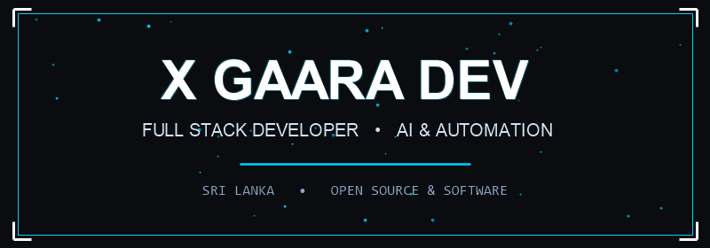
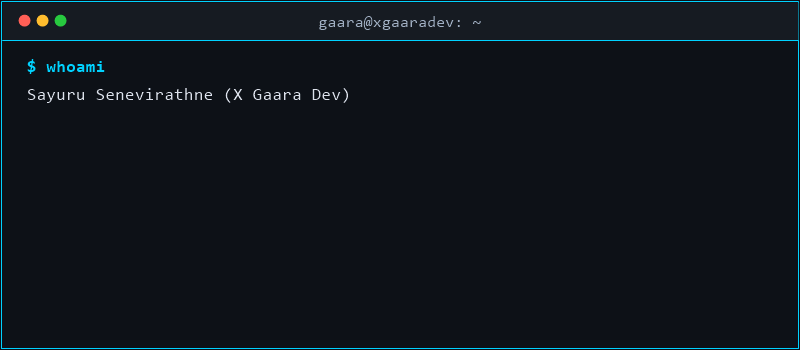

  

  
  
  
  

Hi, I'm **Gaara** (`xgaaradev`) — a passionate **Full Stack Developer** & **Software Engineer**, building modern web applications, APIs, and scalable digital solutions.

- 🚀 Building live platforms: APIs, full-stack web applications, automation & bots
- 💻 Specialised in **Modern Web Development, REST APIs, Backend Services** and **Clean UI/UX**
- 🛡️ Security-first mindset — clean architecture, robust code, hardened deployments
- 🤝 Currently open for **freelance projects & open-source collaborations**

Check out my repositories: **[github.com/xgaaradev](https://github.com/xgaaradev)**

 

  

<table>
  <tr>
    <td width="50%" valign="top">
      
      <h3 align="center"><a href="https://github.com/xgaaradev">Core API & Tools</a></h3>
      
High-performance REST API platform, developer utilities, and web services.

      

        
        
        
      

    </td>
    <td width="50%" valign="top">
      
      <h3 align="center"><a href="https://github.com/xgaaradev">AI & Web Applications</a></h3>
      
Interactive web apps with real-time features, AI endpoints, and responsive design.

      

        
        
        
      

    </td>
  </tr>
</table>

  <b>Languages</b> 
  

  <b>Frontend</b> 
  

  <b>Backend</b> 
  

  <b>Databases</b> 
  

  <b>Cloud & DevOps</b> 
  

  <b>Systems & Security</b> 
  

  <b>Tools & Design</b> 
  

  
  

  
  

  

  

---

  
   
  <b>Let's build something great together.</b>

